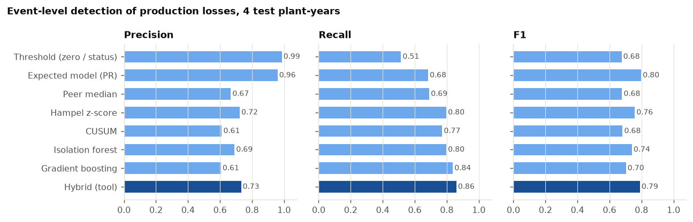
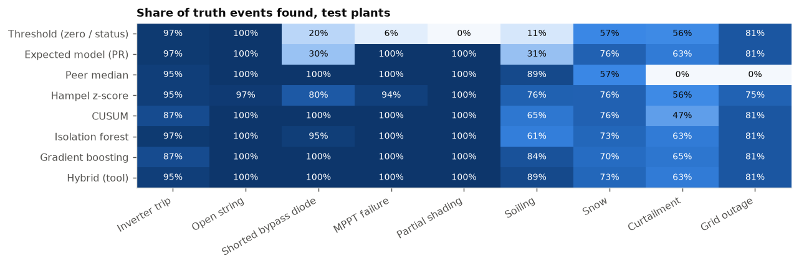
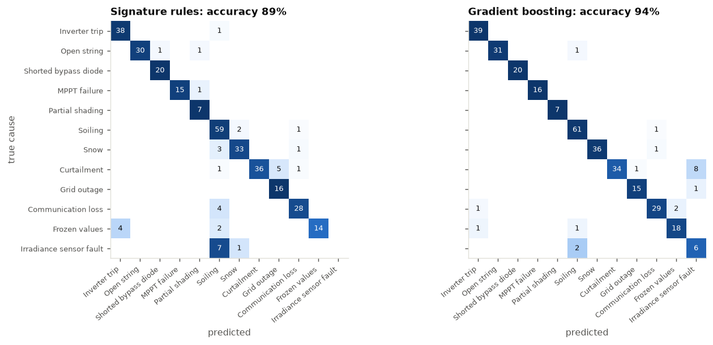
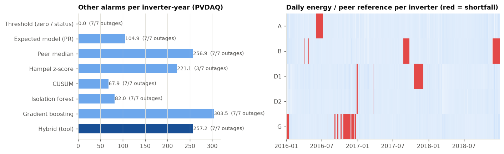
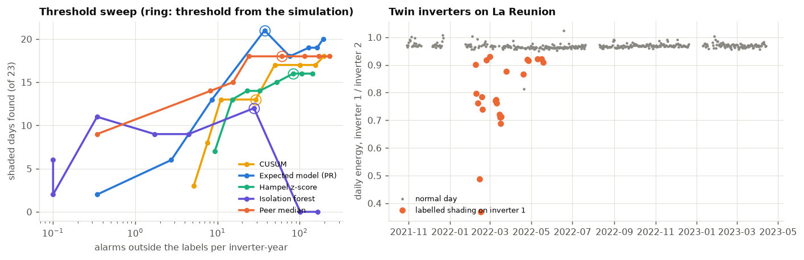

# PV outage classifier: finding, explaining and costing outages at plant, inverter and string level


An asset manager's monthly questions about a PV plant are always the same: what went down, when, why, how much
energy did it cost, and what does that do to the contractual availability? This project compares seven ways of
answering them from ordinary SCADA data (plant meter, inverters, strings, one pyranometer): fixed thresholds, a
pvlib expected-power model, comparison with sibling devices, a Hampel filter, CUSUM, an isolation forest and a
gradient boosting classifier. Causes are assigned from event signatures by rules and by gradient boosting, lost
energy is estimated per event, and the events feed time- and energy-based availability in the spirit of
IEC 61724-1 and IEC TS 63019.

Because public data rarely says what was wrong and when, the methods are scored on **simulated plants with an
exact truth**: 10 inverters × 12 strings, real ERA5 weather from central Poland, single-diode physics down to the
bypass diode, and twelve kinds of events from inverter trips to frozen loggers. Two real datasets then test what
can be tested without a fault log: **five inverters of NREL PVDAQ** (Las Vegas, 2016-2018) and a **rooftop with
two twin inverters and 23 days of labelled shading** (La Réunion, Zenodo).

The same code runs on any plant exported to one long table (schema below), with no adapters to proprietary
formats: `python -m pv_outage run --input plant.parquet`.

Interactive dashboard: **https://kwwaleszczynski-del.github.io/pv-outage-classifier/** (event overview, method
comparison, confusion matrices, availability calculator, real data)



## Key results

### Simulated plants: 4 test plant-years, 272 production-loss events, 60 data problems

Thresholds per level (plant, inverter, string) were tuned for event F1 on four other plant-years with other
weather; the test plants were scored once.

| Method | Precision | Recall | F1 | False alarms / inverter-year | / string-year | Lost energy, median error per event | Availability error, time [pp] |
|---|---|---|---|---|---|---|---|
| Threshold (zero output, status code) | **0.99** | 0.51 | 0.68 | 0.2 | 0.0 | 6 % | 0.03 |
| Expected model (pvlib, PR) | 0.96 | 0.68 | **0.80** | 0.2 | 0.2 | 9 % | 0.03 |
| Peer median (siblings) | 0.67 | 0.69 | 0.68 | 5.0 | 2.6 | 27 % | 0.04 |
| Hampel z-score | 0.72 | 0.80 | 0.76 | 3.8 | 1.9 | 64 % | 0.29 |
| CUSUM | 0.61 | 0.77 | 0.68 | 2.7 | 3.3 | 13 % | 0.06 |
| Isolation forest | 0.69 | 0.80 | 0.74 | 1.9 | 4.3 | 14 % | 0.04 |
| Gradient boosting (supervised) | 0.61 | 0.84 | 0.70 | 26.0 | 6.5 | 13 % | 0.07 |
| **Hybrid (tool default)** | 0.73 | **0.86** | 0.79 | 5.3 | 2.6 | 13 % | 0.04 |

Event-level scores pooled over the test plants (F1 varies by ±0.03-0.09 between plants). Hybrid: peer median for
inverters and strings, expected model for the plant meter, threshold everywhere. Availability error: mean absolute
difference between tool and truth over the test plants, with causes from the rules; truth 99.18-99.35 %.



- **No single detector covers every cause.** Thresholds are almost never wrong but miss everything that is not a
  zero (bypass diodes 20 %, MPPT faults 6 %, soiling 11 %). Peer comparison finds every string-level fault and
  89 % of the soiling episodes without an irradiance sensor, and is blind by construction to whatever hits the
  whole plant at once: curtailment and grid outages 0 %. The expected model sees plant-wide events, but catches
  only 30 % of shorted bypass diodes and 31 % of soiling episodes, and needs 49 and 318 daylight hours for
  bypass diodes and shading: the pyranometer's own scatter hides losses of a few percent. Combining them (the
  hybrid) gives the highest recall, 0.86, at a precision a little above the peer method's.
- **False alarms are blips at low sun.** Of the hybrid's 1472 false alarms on the test plants, 86 % are on single
  strings and the median lasts 30 minutes; on the first test plant the peer method's false alarms sit at a median
  sun elevation of 15° and just past the threshold (4-7 %): a few percent between strings that looks large when
  the irradiance is low. No detector raised a single false alarm
  on clipping except CUSUM (55), the isolation forest (13) and gradient boosting (214). Methods that read the
  pyranometer raise alarms when it is wrong: 97 for the expected model, over a thousand for the isolation forest
  and gradient boosting.
- **Supervised learning finds the most and is the noisiest.** Gradient boosting trained on labelled steps of
  the training plants reaches recall 0.84, but at 26 false alarms per inverter-year it would not survive a
  week in an operations team. On real data it raises 305 alarms per inverter-year (below): it learned the
  simulator.
- **Hampel adapts too well.** Its trailing 7-day median turns a long outage into the new normal, so it ends events
  early: the median duration error is 46 % and the availability error 0.29 pp, ten times the others.
- **Timing and outage energy are right; partial losses are under-counted.** Every method flags an event in the
  same daylight hour it starts (median delay 0 h), except slow causes. Lost energy of outages is within 1-5 % in
  total (trips -5 %, open strings -1 %, curtailment -1 %), but the energy of soiling and snow is under-counted by
  80 % and 57 %: only the part of the episode above the threshold is flagged and costed.
- **Most false alarms disappear if an event must last an hour.** Re-scoring the same test plants with events of at
  least 1 h instead of 30 minutes (a check of one setting after the fact, not a re-tuning) moves the hybrid from
  precision 0.73 / recall 0.86 / F1 0.79 to **0.97 / 0.74 / 0.84**, and its false alarms from 2.9 to 0.13 per
  device-year. What it loses are events that are only ever flagged in pieces shorter than an hour.
- **Availability is robust.** Because time-based availability counts only outages (trips and open strings by
  default) and these are found reliably, every method except Hampel lands within 0.08 pp of the truth.

### What caused it: rules against gradient boosting

| Segmentation | Signature rules | Gradient boosting |
|---|---|---|
| perfect (the true event windows, 332 events) | 89 % | **94 %** |
| pipeline (the hybrid detector's 4147 hits) | 74 % | **91 %** |



- With perfect segmentation the rules get 89 % right with 20 readable lines; the classifier trained on the same
  signatures gets 94 %. The rules' errors are honest ambiguities: a logger frozen at night at zero looks like an
  inverter trip (4 of 20), a curtailment to zero without a status code looks like a grid outage (5 of 43), and
  a drifting pyranometer produces exactly the apparent loss of plant-wide soiling (7 of 8 sensor faults).
- On what the detector actually finds, the gap widens to 74 % vs 91 %: fragments of snow and soiling episodes
  on single strings look like shading or bypass diodes to the rules. A learned classifier handles fragments
  better, if it is trained on the detector's own output, which the rules do not need.
- **Data problems are separated before anything else**: 27 of 32 communication losses and 14 of 20 frozen
  loggers are found as such (only repeated non-zero values count as frozen, so a logger stuck at zero looks like
  an outage), but 0 of 8 irradiance sensor faults: with one pyranometer, a ±10 % drift hides in the day-to-day
  spread of clear-sky irradiance.

### Real data 1: five inverters of NREL PVDAQ, 2016-2018



The fleet has seven plain outages (an inverter at zero for at least two hours in sun while a neighbour
produces): the 12-day stop of building A in June 2016 that the inverter's error code reported 10 days late
(also found by [pv-anomaly-autoencoder](https://github.com/kwwaleszczynski-del/pv-anomaly-autoencoder)), three
weeks of D1 in October-November 2017, B in November-December 2018, and three winter stops of the west-facing
gymnasium G in January 2016. Every method finds all seven except Hampel (3 of 7).

- **Thresholds tuned on a simulated plant of identical inverters do not transfer.** On five roofs with different
  orientations, broken clouds reach the buildings at different times and a quarter-hour mean of one roof can be
  10-25 % off another's: the hybrid detector raises 257 alarms per inverter-year, gradient boosting 305, the
  isolation forest 82, the threshold method none.
- **A site set-up fixes it without labels.** Raising the peer threshold to 15 % and keeping events of at least
  2 h brings the hybrid down to **6.1 other alarms per inverter-year** while still finding all seven outages
  (sweep in the dashboard). With that set-up the fleet's time-based availability is 98.3 % (2016), 98.4 % (2017)
  and 99.0 % (2018).

### Real data 2: labelled shading on twin inverters



A 4 kW rooftop on La Réunion with two identical inverters; inverter 1 was shaded on purpose on 23 days in 2022
and the shading is labelled (Zenodo record 23114394, real records only, averaged to 15 minutes).

| Method | Shaded days found | Alarms outside the labels / inverter-year |
|---|---|---|
| Threshold | 2 / 23 | 0 |
| Expected model | **21 / 23** | 37 |
| Peer (the twin) | 18 / 23 | 60 |
| Hampel | 16 / 23 | 83 |
| CUSUM | 13 / 23 | 29 |
| Isolation forest | 12 / 23 | 28 |
| Gradient boosting (trained on the simulation) | 10 / 23 | 354 |

- The shading is deep (the daily energy ratio of the twins drops from about 0.97 to 0.37-0.93), so the expected model
  and the twin find most days; a stop-or-go threshold finds two.
- **Many "false alarms" of the twin comparison are probably real.** 47 of the alarms on the *reference*
  inverter come back on afternoons from March to September (15-17 h local time), at the same position in the sky
  day after day (median sun-position recurrence 0.93), and the rules classify them as partial shading: the
  reference most likely has an obstruction of its own that the dataset does not label. This is also the limit of a single twin: with one
  reference there is no median to absorb the reference's own problems.
- The rules call 8 of the 18 found days shading, 7 soiling and 3 trips: experimental shading on chosen days does
  not recur with the sun, and a deep, part-day loss of a whole inverter is the only clue left.

## How this fits with the other projects

| Project | Question | Here |
|---|---|---|
| [pv-anomaly-autoencoder](https://github.com/kwwaleszczynski-del/pv-anomaly-autoencoder) | can an autoencoder find subtle plant-level faults (soiling, drift, derating) earlier than PR baselines? | outages and their causes at string and inverter level, availability |
| [pv-shade-fingerprint](https://github.com/kwwaleszczynski-del/pv-shade-fingerprint) | where exactly is a fixed obstruction and what does it cost, from AC power alone? | shading is one of twelve causes; recognised by its sun-position recurrence, not mapped |
| [pv-thermal-check](https://github.com/kwwaleszczynski-del/pv-thermal-check) | are module, inverter and transformer temperatures and sensors right? | module temperature only as a snow clue |
| [grafana-fleet-as-code](https://github.com/kwwaleszczynski-del/grafana-fleet-as-code) | monitoring and alert rules as code, replayed on real data | the offline analysis behind such alerts: which rule, which threshold, how many false alarms, what the event cost |
| [res-uplift-verification](https://github.com/kwwaleszczynski-del/res-uplift-verification) | did an upgrade or an O&M intervention change the yield? | what went wrong, when and why, and what it means for availability |

## Use it on your own data

Everything runs on one long table, Parquet or CSV, one row per device and timestamp:

| column | type | meaning |
|---|---|---|
| `timestamp` | datetime, UTC | start of the averaging interval; any regular step (5, 10, 15 min) |
| `device_id` | string | unique device name |
| `parent_id` | string or empty | the device one level up: string -> inverter -> plant |
| `level` | string | `plant`, `inverter` or `string` |
| `p_ac` | float, kW | AC power of inverters and of the plant meter; empty for strings |
| `i_dc` | float, A | DC current: string current, inverter input current |
| `v_dc` | float, V | DC voltage: the MPPT input voltage on string rows, the input voltage on inverter rows |
| `poa` | float, W/m² | plane-of-array irradiance, usually only on the plant row |
| `t_mod` | float, °C | module temperature, usually only on the plant row |
| `status` | integer, optional | inverter status code, 0 = normal |

Gaps are fine anywhere. A device without its own irradiance or module temperature takes its nearest ancestor's.
Strings that report the same voltage are recognised as sharing an MPPT input. String levels and plant meters are
optional: a plant with inverters only works too (that is what the real-data part uses).

```bash
python -m venv .venv && . .venv/bin/activate        # Windows: .venv\Scripts\activate
pip install -e .
python -m pv_outage run --input my_plant.parquet --meta my_meta.json --out results/my_plant --min-hours 1
```

`--min-hours 1` keeps events of at least one hour: on the simulated plants that cut the false alarms by a factor of
twenty for a small loss of recall (default 0.5 h, as in the benchmark). Thresholds come from `results/thresholds.json`
(tuned on the simulated plants); on a fleet of unlike devices, raise the peer threshold as in the PVDAQ example.

`--meta` is optional JSON:

```json
{"lat": 52.2, "lon": 19.4, "tilt": 25, "azimuth": 180,
 "pdc_kw": {"INV01": 125.0}, "pac_kw": {"INV01": 100.0}, "gamma_pdc": -0.0037,
 "status_map": {"1": "curtailment", "2": "grid_outage", "3": "inverter_trip"}}
```

Location and orientation of the irradiance sensor enable the clear-sky checks; ratings replace the estimates from
the data; `status_map` tells the classifier what a site's status codes mean. `--calibration hour_month` is for
plants whose devices face other ways than the sensor; `--treatment` takes a JSON `{class: unavailable | excluded |
available}` for the KPIs; `--classifier gbm` uses the gradient boosting model trained by `benchmark` instead of the
rules.

Output in `--out`:

- `events.csv`: start, end, device, level, cause (`cls`), category (fault / environment / external / data), lost
  energy (`loss_kwh`; also against the peer reference and against the expected model separately), flagged hours,
  confidence (for rules: how often that rule was right on the training events), source (detector or data
  quality);
- `kpi.json`: time- and energy-based availability, energy, potential energy, lost energy by class and category,
  PR raw, PR with external losses added back, PR with all identified losses added back;
- `kpi_per_inverter.csv`: the same per inverter.

## The simulated plant

Public PV data rarely says *when* something was wrong, *what* it was and *how much* it cost, and without that
truth no method can be scored. The plant is therefore simulated, with every event known to the step and to the
kWh. `python -m pv_outage simulate --year 2023 --seed 11` writes one plant-year in the long format above, plus its
truth table, step labels and metadata.

**Plant.** 10 inverters of 100 kW AC, each with 12 strings of 26 × 400 W modules on six MPPT inputs: 1.25 MWp,
DC/AC 1.25, fixed tilt 30° facing south, in central Poland (51.9° N, 19.5° E).

**Weather.** Real hourly ERA5 (global irradiance, temperature, wind, precipitation, snowfall) from the Open-Meteo
archive, 2021-2024, downscaled to 15 minutes: the hourly clear-sky index is interpolated and given an AR(1)
fluctuation whose amplitude peaks under broken clouds, then every hour is rescaled to its ERA5 energy. Erbs
decomposition and the Perez model give plane-of-array irradiance (1287 kWh/m² in 2023).

**Physics the detectors never see.** Each module is three substrings with a bypass diode, described by the CEC
single-diode model (pvlib); strings on one MPPT input share its voltage, and the input sits at the global maximum
of the summed P-V curve. When an inverter must shed power (clipping at its AC rating, an export set-point) it moves
every input to the right of its MPP, as real inverters do, so the string voltage rises and the current falls.
PVWatts inverter efficiency, incidence-angle losses, Faiman cell temperature, ±0.6 % static string mismatch, cloud
noise between inverters (up to 2 %), and a point pyranometer that sees other clouds than the array (1-5 % noise).
Soiling builds up between rain events of the real precipitation series (Kimber model; three inverters next to a
gravel road soil 4-5 times faster), snow covers and slides off the modules after real snowfall (Marion / NREL model,
strings at the bottom edge stay covered longest), and the module temperature sensor stays near 0 °C under snow.

**Events, about 85 per plant-year:**

| Class | Category | Mechanism | Per year | Duration |
|---|---|---|---|---|
| Inverter trip | fault | inverter off, DC side at open circuit; fault code reported 60 % of the time | 10 | 0.75-6 h (reset) or 1-7 days |
| Open string | fault | blown fuse, string current zero | 8 | 2-25 days |
| Shorted bypass diode | fault | 2-6 of 78 substrings at 0 V (up to two modules) | 5 | 10-60 days |
| MPPT failure | fault | one input stuck at 0.62-0.85 × its MPP voltage | 4 | 2-20 days |
| Partial shading | environment | an obstruction blocks the beam on 3-12 substrings of 1-3 strings when the sun is in its window | 2 | a season or for good |
| Soiling | environment | real rain, Kimber model; an episode is an event once the loss passes 3 % | ~15 | until the next rain ≥ 5 mm/day |
| Snow | environment | real snowfall, coverage and sliding per inverter row | 5-15 | hours to days |
| Curtailment | external | export set-point 0 % (35 %) or 20-70 % of AC rating, status "limited" 80 % of the time | 11 | 1-5 h, spring and summer |
| Grid outage | external | all inverters off, status "grid fault" 90 % of the time | 4 | 0.25-8 h |
| Communication loss | data | values missing for one inverter and its strings, or the whole plant | 8 | 1-72 h |
| Frozen values | data | the logger repeats one inverter's last values (some freeze at night, at zero) | 5 | 2-48 h |
| Irradiance sensor fault | data | pyranometer drift to ±7-15 %, or a pyranometer shaded in the morning | 2 | 3-8 weeks, 1-3 months |

Clipping is not an event: with DC/AC 1.25 the inverters clip on clear spring and summer days, and a detector must
stay quiet. **The truth** is computed, not declared: the plant is solved once per layer (healthy, + soiling,
+ snow, + shading, + device faults, + curtailment and grid outages), and an event's lost energy is the drop
between its layer and the one before, on its inverters, inside its window. A device counts as affected at a
daylight step when its own power drops by more than 1 % (strings) or 0.5 % (inverters, plant) between those layers;
data problems affect their whole window. Loss events without any visible effect (a trip after sunset, a set-point
above what the clouds allowed) are dropped.

**Train and test.** Four plant-years with 2021-2022 weather train and calibrate everything (detector thresholds,
gradient boosting, the rule thresholds); four with 2023-2024 weather are scored once. Each plant has its own events,
layout and noise. 332 test events in all.

## Methods

### Signals and residuals

The primary signal $`y_d(t)`$ of a device is its AC power (inverters, plant meter) or its DC power
$`i_{dc} v_{dc}`$ (strings; the current alone when no voltage is reported). Power, not current: a tracker stuck
below the MPP voltage raises the string current while the power falls. Steps count when the irradiance is above
50 W/m².

**Expected model** (PVWatts with the plant's own calibration):

```math
\hat y_d(t) = \min\left(k_d(G)\,\frac{G(t)}{1000}\,\big(1 + \gamma\,(T_{mod}(t) - 25)\big),\; P_{AC,d}\right), \qquad r^{exp}_d = \frac{y_d}{\hat y_d} - 1
```

$`k_d(G)`$ is the median of $`y_d / (G/1000\,(1+\gamma(T_{mod}-25)))`$ per 50 W/m² irradiance bin over the
analysed period, leaving out outage steps (below 30 % of the device's 80th percentile): binning absorbs low-light
and incidence-angle behaviour and halves the spread of the residual against one constant. A partial fault that
lasts more than about half of the analysed period becomes the device's reference, so analyse a period longer than
the faults you look for. With `--calibration hour_month` the bins are month × quarter-hour of the day instead,
for devices that face other ways than the irradiance sensor; the peer ratio then gets the same baseline. The AC cap $`P_{AC,d}`$ keeps clipping from looking like a loss;
strings are not scored while their inverter clips.

**Peer reference**, no irradiance sensor needed, clouds cancel:

```math
y^{peer}_d(t) = k_d\,\mathrm{median}_{s \in S(d),\, s \neq d}\, \frac{y_s(t)}{k_s}, \qquad r^{peer}_d = \frac{y_d}{y^{peer}_d} - 1
```

over the siblings $`S(d)`$ (strings of one inverter, inverters of one plant) with valid data, at least two.

**Voltage**: $`r^v_d = v_d / \mathrm{median}_{s \neq d}\, v_s - 1`$ against the siblings, and
$`r^{v,self}_d = v_d / \tilde v_d(G, T_{mod}) - 1`$ against the device's own median at that irradiance (100 W/m²
bins) and module temperature (5 K bins). An inverter that sheds power, or sits at open circuit, runs above its MPP
voltage.

**Data quality** (the same for every detector): missing values in daylight; frozen values (every reported channel
unchanged for an hour, non-zero, while the irradiance moved); and the irradiance sensor against clear sky at steps
where production says the sun is out (a clear-shaped day, and the step within 5 % of the day's production level):
the day level and the dip within the day.

### Detectors

| Method | Score per device and step | Threshold per level, tuned on the training plants |
|---|---|---|
| Threshold | zero output in daylight (below 2 % of expected) or a non-zero status code | - |
| Expected model | $`-r^{exp}`$ | shortfall 0.04-0.6 |
| Peer median | $`-r^{peer}`$ | shortfall 0.02-0.4 |
| Hampel | $`z = -(r - \mathrm{med}_{7d}(r)) / (1.4826\,\mathrm{MAD}_{7d}(r))`$, trailing 7 days of the device's own steps | 2-15 |
| CUSUM | $`S_t = \max(0, S_{t-1} + u_t - \kappa)`$, $`u = -(r - \tilde r)/(1.4826\,\mathrm{MAD})`$, $`\kappa = 0.5`$, restart after each alarm, steps back to the last $`S = 0`$ flagged | h = 3-320 |
| Isolation forest | anomaly score on residuals, voltage, zero, plant context, sun elevation, clear-sky index; fitted per level on the plant's own data | quantile 0.85-0.999 |
| Gradient boosting | $`1 - P(\text{normal})`$ of a multi-class classifier on 22 step features, trained on the step labels of the training plants | 0.5 |
| **Hybrid (tool)** | peer median for inverters and strings, expected model for the plant meter, threshold everywhere | those of its parts |

Hampel and CUSUM use $`r^{peer}`$ where a device has siblings and $`r^{exp}`$ otherwise (the plant meter).

**From flags to events.** When at least 80 % of an inverter's strings are flagged at once, the inverter takes the
flag and the strings lose it (the same for inverters under a plant); a parent at zero explains whatever its
children show; a parent's partial loss that is already explained by some flagged children is dropped in favour of
the children. Flagged daylight steps then form events per device; gaps of up to 2 h are bridged and nights never
split an event, so a five-day outage is one event. Events need at least two flagged steps.

**Lost energy** of an event: $`\sum_t \max(0, y^{ref}_d(t) - y_d(t))\,\Delta t`$ over its daylight steps, with
the peer reference where it exists for at least half of them and the expected model otherwise (string DC power
times 0.98 for the inverter).

### Cause

Both classifiers see the same signature of an event, computed over its flagged steps: level, span, flagged hours,
zero share, depth against the siblings and against the expected model, trend (slow onset), voltage against
siblings and against its own normal (for a plant-wide event: over its inverters), whether the MPPT twin is low too,
sun-position recurrence (how much more often the device ran low with the sun in the same 5° × 3° patch of sky than
elsewhere), share of low-sun steps, share of the affected days' sunny steps it covers, share of siblings and of the
plant's inverters low at the same time, median module temperature, the irradiance-sensor checks, status codes
(with an optional map of what they mean), missing and frozen shares.

**Rules** (`classify.rule`, in order): missing data, frozen data, a status code with a known meaning; then by level.
Plant: sensor check failed → sensor fault; at zero → snow if the modules are cold and the voltage is not raised,
else grid outage; voltage raised → curtailment; cold → snow; otherwise soiling. Inverter: cold and the plant low →
snow; at zero → trip; plant low and voltage raised → curtailment; shallow → soiling; deep → trip. String: cold and
many strings low → snow; at zero → open string; part of the day only, with low sun or a recurring sun position →
partial shading; voltage 10 % off the other inputs → MPPT failure; otherwise a shorted bypass diode.

**Gradient boosting** (scikit-learn `HistGradientBoostingClassifier`, class-balanced, capped at 5×) is trained
on the same signatures of the training plants' events: the true windows and the hybrid detector's hits.

### KPIs

Time-based availability, weighted by capacity (an inverter is 1/N of the plant, a string 1/(N × 12)) over daylight
steps:

```math
A_t = 1 - \frac{\sum_t \sum_i w_i\, \ell_t\, u_{t,i}}{\sum_t \sum_i w_i\, \ell_t\, (1 - x_{t,i})}, \qquad A_E = 1 - \frac{E_{lost,unavailable}}{E_{measured} + E_{lost,all} - E_{lost,excluded}}
```

$`u_{t,i}`$ is the share of inverter $`i`$ that is down for a cause treated as unavailable, $`x_{t,i}`$ the share
excluded (external causes, unknown state), $`\ell_t`$ daylight. Default treatment: trips and open strings
unavailable; grid outages, curtailment, communication loss and frozen values excluded; everything else available
(it shows up in the performance ratio instead). PR is reported raw, with external losses added back, and with all
identified losses added back. This follows the spirit of IEC 61724-1 (performance ratio, irradiance threshold) and
IEC TS 63019 (availability information categories); the exact definitions there, and in a given contract, need to
be checked against the current editions.

### Scoring

A detection is a hit when at least half of its flagged steps fall on steps where the truth says its device was
affected; it belongs to the truth event behind most of them. Precision = hits / detections, recall = truth events
with at least one hit / truth events, both over production-loss classes only, so alarms caused by a faulty
irradiance sensor stay false alarms. Delay = daylight hours from the event's first visible effect to the first
flagged step. Duration error compares flagged hours with the truth's affected hours; energy error compares the
summed lost energy of an event's hits with the truth. False alarms per device-year count unmatched detections per
device of each level.

## Limitations

- **The headline numbers are synthetic.** The simulator is physical (single-diode substrings, MPPT behaviour,
  real weather, soiling and snow models), but the events, their frequencies and the sensor noise are choices. Real
  plants have failure modes it does not have (inverter derating, partial power-stage failures, PID, tracker
  faults, transformer trips) and noise it does not model. The two real datasets check what can be checked without
  a fault log.
- **Thresholds tuned on a simulated plant with identical inverters do not transfer as they are.** On the PVDAQ
  campus, five inverters on roofs with different orientation, they raise hundreds of alarms per inverter-year:
  broken clouds reach the buildings at different times, and a quarter-hour mean of one roof can be 10-25 % off
  another's. A site needs its own set-up; the sweep in the dashboard is the tool for it.
- **Calibration is retrospective.** Expected model and peer baselines are fitted on the analysed period (median,
  outages left out). A partial fault that lasts more than about half of that period becomes the reference.
- **Status codes are site-specific.** Without a `status_map`, a curtailment to zero and a grid outage look the
  same in power and voltage, and the tool calls both a grid outage.
- **One irradiance sensor cannot check itself well.** The clear-sky test catches a shadow on the sensor within a
  day; a slow drift of ±10 % hides in the day-to-day spread of clear-sky irradiance (haze, and here the ERA5
  downscaling), so sensor drift is mostly missed and its apparent losses are classified as soiling.
- **The real shading test has one twin.** Peer comparison with a single reference has no median to absorb the
  reference's own problems; the reference inverter turned out to be shaded on winter afternoons itself.
- **IEC 61724-1 / IEC TS 63019** are followed in spirit; the availability categories and the treatment of partial
  capability, external causes and data gaps are configurable because contracts differ. Check the definitions
  against the current editions and the contract before using the numbers for a guarantee.

## Reproduce

```bash
python -m venv .venv && . .venv/bin/activate        # Windows: .venv\Scripts\activate
pip install -e ".[dev]"
pytest -q                                            # 37 tests, offline, under a minute
python -m pv_outage fetch-weather                    # ERA5 for one point, 2021-2024 (Open-Meteo, ~3 MB)
python -m pv_outage benchmark --jobs 4               # 8 simulated plant-years, all methods (~1 h on a laptop)
python -m pv_outage sensitivity                      # the test plants with longer minimum events
python -m pv_outage real                             # NREL PVDAQ (downloads ~60 MB once)
python -m pv_outage shading                          # labelled shading (needs data/zenodo, see below)
python -m pv_outage report                           # docs/img and docs/data.js
```

Results land in `results/` (committed: summary, per-plant and per-event tables, thresholds); raw and simulated data
in `data/` (git-ignored). The shading test expects `final_pv_fault_dataset.csv` (69 MB) from the Zenodo record in
`data/zenodo/`; only results derived from it are in this repository.

## Data and licences

| Source | What | Licence |
|---|---|---|
| [ERA5](https://cds.climate.copernicus.eu/) (Copernicus Climate Change Service) via the [Open-Meteo](https://open-meteo.com/) archive API | hourly irradiance, temperature, wind, precipitation and snowfall at 51.9° N 19.5° E, 2021-2024 | CC BY 4.0 |
| [NREL PVDAQ](https://doi.org/10.25984/1846021), systems 34, 35, 1276, 1278 | 15-min inverter AC power, DC current and voltage, error codes, POA irradiance, module temperature, 2016-2018 | CC BY 4.0 |
| [PV Array Fault Dataset](https://zenodo.org/records/23114394), Zenodo record 23114394, real records only | 60-s measurements of two twin 2 kW inverters with labelled real shading on inverter 1, La Réunion, 2021-2023; built on Graillet et al. (2022), https://doi.org/10.5281/zenodo.7828879 | CC BY 4.0 |
| [pvlib](https://pvlib-python.readthedocs.io) | CEC module database (Jinko JKM400M-72L), clear sky, transposition, Kimber soiling, NREL snow model | BSD-3 |

Deline, C., Perry, K., Deceglie, M., Muller, M., Sekulic, W., & Jordan, D. (2021). Photovoltaic Data Acquisition
(PVDAQ) Public Datasets. Open Energy Data Initiative (OEDI), NREL. https://doi.org/10.25984/1846021

Graillet, A. et al. (2022). Electrical production data of a domestic grid-connected rooftop PV plant in normal and
shading faults conditions associated with solar and meteorological data in a tropical climate. Zenodo.
https://doi.org/10.5281/zenodo.7828879 (the aligned subset used here: Zenodo record 23114394, CC BY 4.0).

## References

- IEC 61724-1:2021, Photovoltaic system performance - Part 1: Monitoring.
- IEC TS 63019:2019, Photovoltaic power systems (PVPS) - Information model for availability.
- Kimber, A. et al. (2006). The effect of soiling on large grid-connected photovoltaic systems in California and
  the southwest region of the United States. IEEE 4th World Conference on Photovoltaic Energy Conversion.
- Marion, B. et al. (2013). Measured and modeled photovoltaic system energy losses from snow for Colorado and
  Wisconsin locations. Solar Energy 97, 112-121.
- Page, E. S. (1954). Continuous inspection schemes. Biometrika 41, 100-115 (CUSUM).
- Liu, F. T., Ting, K. M., Zhou, Z.-H. (2008). Isolation forest. IEEE ICDM.
- Holmgren, W. F., Hansen, C. W., Mikofski, M. A. (2018). pvlib python: a python package for modeling solar energy
  systems. Journal of Open Source Software 3(29), 884.

## Licence

MIT
